# ✧ Welcome to the Midnight Glasshouse ✧

*Some ideas bloom quietly. Others change everything.*

**AI Research · Responsible Machine Learning · Agentic Systems · Software Engineering**

[🌸 Explore the garden](#-the-garden-of-projects) · [🔭 Research](#-the-observatory) · [🪴 Toolkit](#-the-workbench) · [🌙 All repositories](https://github.com/ShreeyaKamath?tab=repositories)

---

### 🌙 Hello, I'm Shreeya

I build at the intersection of **artificial intelligence, thoughtful engineering, and real-world problems**. I enjoy translating ideas into working systems — from probabilistic inference and fairness-aware ML to multi-agent applications.

I care about how intelligent systems work, how we evaluate them, and whether we can trust their decisions.

### 🌷 The garden of projects

*Five pathways through the glasshouse. Each one leads to a real repository.*

| Pathway | Project | What you'll discover |
|:--|:--|:--|
| 🌸 **The Fairness Grove** | [Fairness Preservation Under Computational Budgets](https://github.com/ShreeyaKamath/Fairness-Preservation-Under-Computational-Budgets-AFGML) | Fairness-aware decisions under computational inference constraints |
| 🦋 **The Agent Conservatory** | [MedTrust](https://github.com/ShreeyaKamath/MedTrust) | Multi-agent clinical decision support research |
| 🌷 **The Responsible AI Meadow** | [FAIRPATH-EDU](https://github.com/ShreeyaKamath/FAIRPATH-EDU) | Fairness-focused AI applications |
| 🍃 **The Engineering Greenhouse** | [ManipalDMS](https://github.com/ShreeyaKamath/ManipalDMS) | Document management with C# Windows Forms and SQL Server |
| ✨ **The Learning Pavilion** | [Interactive Learning Platform](https://github.com/ShreeyaKamath/Interactive-Learning-Platform) | Interactive educational software |

### 🔭 The observatory

- **Research interests:** machine learning, probabilistic models, trustworthy AI, fairness evaluation
- **Things I build:** LLM-based systems, multi-agent workflows, software applications
- **How I work:** question → design → prototype → evaluate → improve
- **Currently exploring:** AI & Decision Science, reproducible research, and applied engineering

### 🪴 The workbench

`Python` · `C#` · `SQL` · `HTML/CSS` · `Git` · `GitHub` · `Docker` · `SQL Server` · `Jupyter`

🗝️ A secret door: how the glasshouse comes alive

The scene above is an **animated SVG**: clouds drift, stars twinkle, flowers gently sway, the moon glows, and a butterfly floats through the conservatory. The animation does **not** depend on commits, contribution streaks, or daily activity. It's designed to be beautiful even during quiet periods of research and learning.

GitHub README pages don't run custom JavaScript, so the scene uses lightweight SVG animation instead. For an interactive 3D garden, a separate website would be needed.

---

*✧ Stay curious. Build with care. Let ideas bloom. ✧*

