<div align="center">



# 🌲 The Forest of Forgotten Paths

*Every question opens a new trail.*

**Shreeya Kamath** · AI Research · Responsible Machine Learning · Agentic Systems · Software Engineering

[](https://github.com/ShreeyaKamath)

[**Explore the trails**](#-the-five-research-trails) · [**The research map**](#-the-research-map) · [**Field equipment**](#-field-equipment) · [**All repositories**](https://github.com/ShreeyaKamath?tab=repositories)

</div>

---

## 🌿 A field note

I work where **mathematical ideas meet practical intelligent systems**. I'm interested in probabilistic inference, fairness-aware ML, agentic applications, and software engineering — especially the questions that remain after a model produces an answer: *Is it reliable? Is it fair? Can we explain it?*

This forest is my map of those questions. The paths branch, reconnect, and occasionally lead somewhere unexpected.

## 🧭 The research map

```text
                       A QUESTION
                           │
                    ┌──────┴──────┐
                    │  Observe    │  ← data & context
                    └──────┬──────┘
                           │
                     ┌─────▼─────┐
                     │  Model    │  ← ML, PGM, LLMs
                     └─────┬─────┘
                           │
                ┌──────────┼──────────┐
                ▼          ▼          ▼
            INFERENCE   FAIRNESS   AGENTS
                │          │          │
                └──────────┼──────────┘
                           ▼
                     EVALUATE
                           │
                    BUILD BETTER
```

*Not a single straight road: my interests connect theory, evaluation, and implementation.*

## 🍄 The five research trails

| Trail | Project | What lives here |
|:--|:--|:--|
| **01 · The Inference Grove** | [Fairness Preservation Under Computational Budgets](https://github.com/ShreeyaKamath/Fairness-Preservation-Under-Computational-Budgets-AFGML) | Probabilistic inference, computational budgets, and fairness-aware decisions |
| **02 · The Agent Trail** | [MedTrust](https://github.com/ShreeyaKamath/MedTrust) | Multi-agent clinical decision support research |
| **03 · The Fairness Clearing** | [FAIRPATH-EDU](https://github.com/ShreeyaKamath/FAIRPATH-EDU) | Fairness-focused AI applications |
| **04 · The Systems Workshop** | [ManipalDMS](https://github.com/ShreeyaKamath/ManipalDMS) | Document management using C# Windows Forms and SQL Server |
| **05 · The Learning Meadow** | [Interactive Learning Platform](https://github.com/ShreeyaKamath/Interactive-Learning-Platform) | Educational software and interactive experiences |

## 🧠 Patterns hidden in the forest

| In nature | In AI & ML |
|:--|:--|
| 🌳 **Branches split** | Decision trees partition the feature space through successive decisions |
| 🍃 **A canopy is interconnected** | Neural networks learn through layers of connected units |
| 🧭 **Paths have trade-offs** | Optimization balances objectives, constraints, and computational cost |
| ✨ **Fireflies exchange signals** | Agentic systems coordinate through messages, tools, and shared context |
| 🌱 **Ecosystems need balance** | Fairness evaluation asks how model outcomes differ across groups |
| 🔍 **Field observations matter** | Experiments, validation, and reproducibility ground research claims |

## 🧰 Field equipment

**Languages:** `Python` · `C#` · `SQL` · `HTML/CSS`

**Research:** `Machine Learning` · `Probabilistic Models` · `Fairness Evaluation` · `LLMs` · `Multi-agent Systems`

**Engineering:** `Git` · `GitHub` · `Docker` · `SQL Server` · `Jupyter`

<details>
<summary><b>🔎 Open the explorer's notebook — how the forest moves</b></summary>

The forest banner is an original, lightweight SVG illustration. A firefly follows a winding path; glowing points form a small neural-network-like graph; distant mist drifts slowly; and tiny lights pulse between the trees.

These animations run independently of commits, contribution streaks, or other GitHub activity. The network is a visual metaphor, not a claim that a model is executing inside the README. GitHub restricts scripts, so interactive model demos belong in linked project repositories or a separate website.

</details>

<div align="center">

---

*Follow the question. Test the idea. Keep exploring.*

</div>