# 🪼 Shreeya Kamath

### 🌊 Curiosity runs deep.

**AI / ML · Responsible AI · Agentic Systems · Software Engineering**

*I enjoy turning complex ideas into thoughtful, working systems — from probabilistic inference and fairness-aware ML to multi-agent applications.*

---

### 🔬 Explore the observatory

**Choose a research station ↓**

[🪼 **Enter the interactive Underwater Observatory**](https://shreeyakamath.github.io/ShreeyaKamath/) · [View source](https://github.com/ShreeyaKamath/ShreeyaKamath/blob/main/index.html)

[🪼 **Inference Lab**](https://github.com/ShreeyaKamath/Fairness-Preservation-Under-Computational-Budgets-AFGML) · [🐙 **Agentic Lab**](https://github.com/ShreeyaKamath/MedTrust) · [🪸 **Responsible AI Lab**](https://github.com/ShreeyaKamath/FAIRPATH-EDU)

[🐚 **Engineering Lab**](https://github.com/ShreeyaKamath/ManipalDMS) · [🐠 **Learning Lab**](https://github.com/ShreeyaKamath/Interactive-Learning-Platform) · [🔎 **All Repositories**](https://github.com/ShreeyaKamath?tab=repositories)

Tap a research station to visit a real project.

## 🌊 What I'm exploring

- 🎓 Studying **AI & Decision Science**.
- 🐚 Exploring **machine learning, fairness, probabilistic inference, and trustworthy AI**.
- 🌊 Building with **LLMs, multi-agent systems, and applied software engineering**.
- 🏄 Growing through research, experiments, and open-source learning.

## 🔬 Featured research & projects

| Station | Project | What it explores |
|:--|:--|:--|
| 🪼 Inference Lab | [Fairness Preservation Under Computational Budgets](https://github.com/ShreeyaKamath/Fairness-Preservation-Under-Computational-Budgets-AFGML) | Fairness-aware decisions under inference constraints |
| 🐙 Agentic Lab | [MedTrust](https://github.com/ShreeyaKamath/MedTrust) | Multi-agent clinical decision support research |
| 🪸 Responsible AI Lab | [FAIRPATH-EDU](https://github.com/ShreeyaKamath/FAIRPATH-EDU) | Fairness-focused AI applications |
| 🐚 Engineering Lab | [ManipalDMS](https://github.com/ShreeyaKamath/ManipalDMS) | Document management software |
| 🐠 Learning Lab | [Interactive Learning Platform](https://github.com/ShreeyaKamath/Interactive-Learning-Platform) | Educational software development |

## 🧰 My toolkit

**Languages:** Python · C# · SQL · HTML/CSS  
**AI & data:** Machine Learning · Probabilistic Models · Fairness Evaluation · LLMs  
**Engineering:** Git · GitHub · Docker · SQL Server · Jupyter Notebooks

🫧 Open the research log — what I'm interested in

I'm particularly interested in how to build AI systems that are **useful, reliable, interpretable, and fair**. I like the space where theoretical ML meets real implementations: experiments, evaluation, thoughtful architecture, and reproducible research.

---

*🪼 Build with purpose. Explore with curiosity. 🌊*

