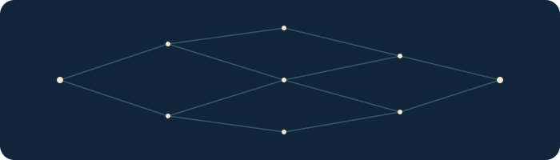

# Shreeya Kamath

### Where the Stars Meet the Sea

*Exploring intelligence, one constellation at a time.*

**Artificial Intelligence · Machine Learning · Generative AI · Intelligent Systems · Software Development**

[Projects](#selected-projects) · [Interests](#current-orbit) · [Toolkit](#toolkit) · [Repositories](https://github.com/ShreeyaKamath?tab=repositories)

## About me

I'm passionate about AI and Machine Learning, and curious about what thoughtful technology can make possible. I enjoy experimenting with new ideas, turning them into meaningful projects, and learning through the process of building. My interests span Generative AI, intelligent systems, and software development—but my curiosity is never limited to one field.

  

## Selected projects

|  | Project | What it explores |
|:--:|:--|:--|
| **01** | [**Fairness Preservation Under Computational Budgets**](https://github.com/ShreeyaKamath/Fairness-Preservation-Under-Computational-Budgets-AFGML) | Fairness-aware Bayesian-network inference when computation and evidence are constrained |
| **02** | [**MedTrust**](https://github.com/ShreeyaKamath/MedTrust) | A zero-trust, provenance-aware multi-agent framework for clinical decision support |
| **03** | [**FAIRPATH-EDU**](https://github.com/ShreeyaKamath/FAIRPATH-EDU) | Causal and counterfactual fairness auditing for early student-risk prediction using OULAD |
| **04** | [**ManipalDMS**](https://github.com/ShreeyaKamath/ManipalDMS) | A C# and SQL Server document-management application with role-based access and audit logging |
| **05** | [**Interactive Learning Platform**](https://github.com/ShreeyaKamath/Interactive-Learning-Platform) | A responsive learning experience with video lessons, quizzes, accessibility, and local progress tracking |
| **06** | [**Wrap World**](https://github.com/ShreeyaKamath/Wrap-World) | An interactive browser puzzle adventure that turns topology, wrapped spaces, and twisted geometry into playable challenges |

  

## Current orbit

**Artificial Intelligence & Machine Learning** · **Generative AI & LLMs** · **Multi-agent Systems** 
**Responsible AI & Fairness** · **Probabilistic Graphical Models** · **Software Development**

## Toolkit

| Languages | AI & exploration | Engineering |
|:--|:--|:--|
| `Python` · `C#` · `SQL` · `HTML/CSS` | `Machine Learning` · `LLMs` · `Jupyter` | `Git` · `GitHub` · `Docker` · `SQL Server` |

  

  *Stay curious. Build with care. Keep looking beyond the horizon.*

  [Explore all repositories](https://github.com/ShreeyaKamath?tab=repositories)

