# ✧ Shreeya Kamath ✧

*Somewhere between research, imagination, and code.*

**AI / ML · Responsible AI · Agentic Systems · Software Engineering**

**[✦ Explore my projects](#-constellations-of-work) · [☾ Research interests](#-inside-the-observatory) · [✧ Toolkit](#-tools-in-my-orbit) · [↗ All repositories](https://github.com/ShreeyaKamath?tab=repositories)**

---

### ✨ A little about me

I turn complex questions into thoughtful, working systems — from **probabilistic inference and fairness-aware ML** to **multi-agent applications** and practical software engineering.

I care about what an intelligent system *does*, how we *evaluate* it, and whether we can *trust* its decisions.

### 🌌 Constellations of work

| Constellation | Explore | What it investigates |
|:--|:--|:--|
| ✦ **Inference & fairness** | [Fairness Preservation Under Computational Budgets](https://github.com/ShreeyaKamath/Fairness-Preservation-Under-Computational-Budgets-AFGML) | Fairness-aware decisions under inference constraints |
| ☾ **Agentic intelligence** | [MedTrust](https://github.com/ShreeyaKamath/MedTrust) | Multi-agent clinical decision support research |
| ✧ **Responsible AI** | [FAIRPATH-EDU](https://github.com/ShreeyaKamath/FAIRPATH-EDU) | Fairness-focused AI applications |
| ☁️ **Software engineering** | [ManipalDMS](https://github.com/ShreeyaKamath/ManipalDMS) | C# Windows Forms and SQL Server document management |
| 🌠 **Interactive systems** | [Interactive Learning Platform](https://github.com/ShreeyaKamath/Interactive-Learning-Platform) | Educational software development |

### 🔭 Inside the observatory

- **Research:** machine learning, probabilistic models, fairness evaluation, trustworthy AI
- **Building:** LLMs, agentic workflows, applied AI and software engineering
- **Approach:** question → prototype → experiment → evaluate → improve
- **Currently:** studying AI & Decision Science, building projects, and exploring reproducible research

### 🪐 Tools in my orbit

`Python` · `C#` · `SQL` · `HTML/CSS` · `Git` · `GitHub` · `Docker` · `SQL Server` · `Jupyter`

☁️ Open a cloud: the research philosophy behind my work

I like the intersection of **mathematical ideas and working systems**. My interests include inference under constraints, evaluation beyond accuracy, responsible AI, and building software that makes complex ideas useful.

The sky illustration above is an animated SVG. A GitHub Actions workflow refreshes its star field using **public GitHub contribution-calendar data**. The displayed contribution count is not a claim about commits alone: GitHub contributions can include other qualifying activity.

---

*✧ Stay curious. Build with purpose. Leave a little light behind. ✧*

